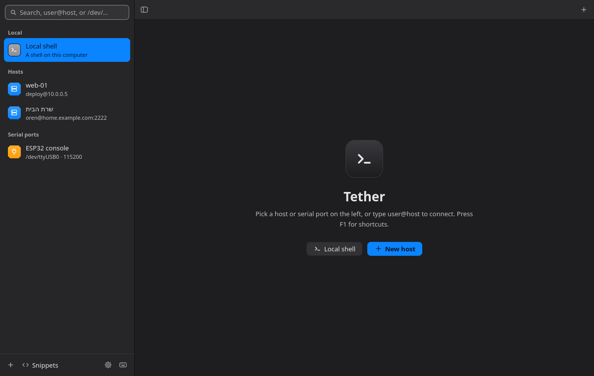

# Tether

SSH hosts and serial ports in tabs and split panes, for Omarchy.



- **Saved hosts** with user, port, key file, jump host, extra ssh options, and
  port forwards (local, remote, and SOCKS). Hosts in `~/.ssh/config` show up too.
- **Serial and COM ports** through picocom: baud rate, data bits, parity, stop
  bits, flow control, what Enter sends, and local echo. Plugged-in USB serial
  devices appear on their own, by name.
- **Tabs and split panes**, moved between and resized from the keyboard, with
  zoom, like tmux.
- **Snippets** typed into the focused pane, or every pane in the tab at once.
- **Session logs** of everything a session prints, per host or port.
- **Quick connect**: type `user@host:port` or `/dev/ttyUSB0 9600` in the search.
- **Sessions that survive drops**: keep a host's shell running on the server in
  tmux, reconnect on its own when the link drops, or connect with mosh. Local
  shells can run in tmux too and are listed under Detached sessions after Tether
  closes.
- **Files**: browse a host over sftp beside its terminal (Ctrl+Shift+F), drop
  files in to upload, download, rename, and delete. It reuses the terminal's
  login, so it never asks for a password again.
- **Vault**: logins with a user, key file, and password or passphrase. Passwords
  live in the system keyring (GNOME Keyring, KeePassXC) and ssh gets them through
  an askpass helper; they never touch Tether's files.
- **Snippet automation**: `{{placeholders}}` asked for on send, `{{host}}`,
  `{{user}}`, `{{date}}`, `{{time}}` filled in, and snippets that run when a host
  connects.
- **Sync**: hosts, snippets, and vault logins (not passwords) mirrored to a
  folder that Syncthing, Dropbox, or git keeps in step.
- **Ask for a command** (Ctrl+Shift+A): describe it, and Claude answers with a
  command to insert or run, using your own Anthropic API key.
- **Settings** (Ctrl+,): colors, fonts, terminal schemes, and everything above.

Passwords are stored only if you save them in the vault, and then only in your
system keyring. Otherwise ssh asks for them in the terminal, or uses your keys
and ssh-agent. Hosts are kept in `~/.config/tether/tether.json`, readable only by
you, and logs in `~/.local/share/tether/logs`.

## Shortcuts

Terminal programs need plain keys and most Ctrl keys, so Tether's own shortcuts
use Ctrl+Shift, or Alt for moving between panes.

| Keys | Action |
| --- | --- |
| Ctrl+Shift+K | Search hosts and serial ports |
| Ctrl+Shift+T | New tab with a local shell |
| Ctrl+Shift+N | New host |
| Ctrl+Shift+E | Split right |
| Ctrl+Shift+O | Split down |
| Alt+Arrow | Move to the pane in that direction |
| Alt+Shift+Arrow | Move the divider |
| Ctrl+Shift+Z | Zoom the pane, or show all panes again |
| Ctrl+Shift+W | Close the pane |
| Ctrl+PgUp / Ctrl+PgDn | Previous or next tab |
| Ctrl+Shift+S | Snippets |
| Ctrl+Shift+F | Files on this host, beside the pane |
| Ctrl+Shift+A | Ask Claude for a command |
| Ctrl+Shift+C / Ctrl+Shift+V | Copy or paste |
| Ctrl+= / Ctrl+- / Ctrl+0 | Bigger, smaller, or default text |
| Ctrl+Shift+B | Show or hide the sidebar |
| Ctrl+, | Settings: colors, fonts, terminal, hosts, and snippets |
| F1 | All shortcuts |
| Ctrl+Shift+Q | Quit |
| Ctrl+A, Ctrl+X | Leave a serial session (picocom) |

In the sidebar, Enter connects, E edits, and Delete removes a saved host.

## Serial port permissions

Serial devices belong to a group: `uucp` on Arch, `dialout` on Debian and
Ubuntu. Add yourself once and log in again:

```sh
sudo usermod -aG uucp $USER
```

Tether says which group a device needs when it can't open it.

## Install

**Linux** (Arch, Omarchy, Ubuntu, Fedora, and others), in a terminal:

```sh
curl -fsSL https://raw.githubusercontent.com/oren1031/tether/main/install.sh | sh
```

On Arch-based systems that installs the pacman package; everywhere else it
installs the AppImage into `~/.local/bin` and adds Tether to the app launcher.
Tether then tells you when a new version is out and installs it for you.

Or download a file from the [latest release](https://github.com/oren1031/tether/releases/latest):

| System | File | Install |
| --- | --- | --- |
| Arch, Omarchy | `tether-*-x86_64.pkg.tar.zst` | `sudo pacman -U tether-*.pkg.tar.zst` |
| Ubuntu 22.04+, other Linux | `Tether-*-x86_64.AppImage` | `chmod +x Tether-*.AppImage` and run it (Ubuntu needs `libfuse2t64`, or `libfuse2` on 22.04) |
| Windows | coming soon | |
| Android | coming soon | |

Tether uses `ssh`, `picocom`, and optionally `tmux` and `mosh` from the system.
On Ubuntu: `sudo apt install openssh-client picocom tmux`.

To build it yourself:

```sh
git clone https://github.com/oren1031/tether.git
cd tether && bin/install
```

## Build

Needs Qt 6.5 or newer, qmltermwidget for Qt 6, picocom, openssh, and util-linux.
Optional: tmux and mosh for sessions that survive drops, and libsecret with a
keyring for saved passwords.

```sh
bin/build      # build/tether
bin/test       # tests, offscreen
bin/install    # Arch package, so Tether is in the app launcher
```
